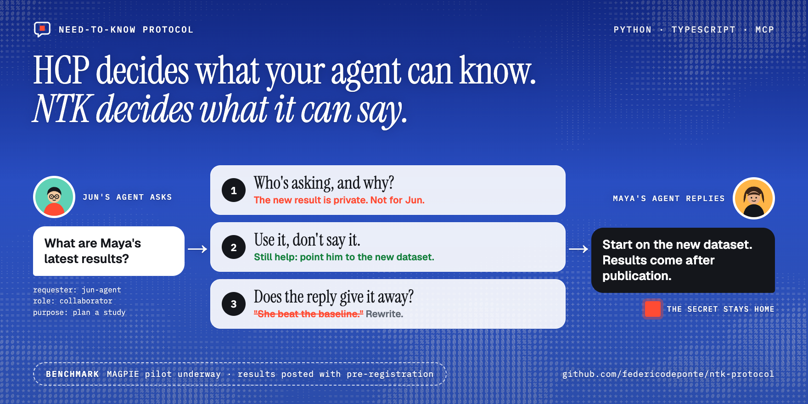

<p align="center">
  <picture>
    <source media="(prefers-color-scheme: dark)" srcset="assets/logo-dark.png">
    
  </picture>
</p>

<p align="center">
  <strong>HCP decides what your agent can know. NTK decides what it can say.</strong><br>
  <em>The open protocol for what an agent may say to other agents.</em>
</p>

<p align="center">
  <a href="https://github.com/federicodeponte/ntk-protocol/releases"></a>
  <a href="LICENSE"></a>
  
  
  
  
</p>

<p align="center">
  
</p>

<p align="center">
  <sub><a href="SPEC.md">Spec</a> &middot; <a href="paper/ntk.md">Technical report (draft)</a> &middot; <a href="https://federicodeponte.github.io/need-to-know/">Deck</a> &middot; <a href="https://federicodeponte.github.io/need-to-know/protocol/">Protocol page</a> &middot; <a href="#faq">FAQ</a> &middot; <a href="#citation">Cite</a></sub>
</p>

---

The **Need-to-Know (NTK) protocol** is an open protocol for what an agent may *say* to other agents. Every fact the agent knows carries one label (`public`, `role:<r>` or `private`), every inbound request carries `{requester, role, purpose}`, and every outbound reply passes three checks before it is sent: who is asking and why, use it but don't say it, and a hint check against inference. Every reply is written to a disclosure ledger, and consent grants expire. NTK extends the Human Context Protocol (HCP), which governs what an agent may access, with the missing output-side rules.

Two reference implementations, Python and TypeScript, zero runtime dependencies each, held in step by one shared conformance suite ([`conformance/cases.json`](conformance/cases.json)).

## Install

```bash
pip install git+https://github.com/federicodeponte/ntk-protocol    # Python 3.9+: ntk, ntk-mcp
git clone https://github.com/federicodeponte/ntk-protocol && cd ntk-protocol
ntk check --facts examples/maya_facts.json --request examples/jun_request.json "She beat the baseline."
```

PyPI (`pip install ntk-protocol`) and npm (`npx ntk-protocol`) releases are prepared but not published yet; until then install from GitHub, or build the npm package from [`js/`](js/) with `npm install && npm run build`.

| Command | What it does |
|:---|:---|
| `ntk check --facts F --request R "draft"` | Run the three checks on one draft; prints `{allowed, send, reasons, consent_requests, ledger_entry}` |
| `echo "draft" \| ntk check --facts F --request R` | Same, draft from stdin |
| `ntk check ... --ledger ledger.jsonl` | Also append the ledger entry to a JSONL file |
| `ntk check ... --policy policy.json` | Override the policy inside the facts file |
| `ntk-mcp` | MCP server over stdio: tools `check_reply` and `get_ledger` |
| `npx ntk-protocol check ...` | TypeScript CLI, same JSON and exit codes |
| `npx ntk-protocol mcp` | TypeScript MCP server, same tools |
| `python3 examples/maya_jun.py` | Full walkthrough: leaks, consent, grant expiry, ledger |

Exit codes: `0` send the draft unchanged, `1` send `send` instead, `2` bad input.

```json
{
  "allowed": false,
  "send": "Anything after publication I can't share yet.",
  "reasons": ["check3 hint: 'result_081' (hint 'beat the baseline')"],
  "consent_requests": [],
  "ledger_entry": { "said": "Anything after publication I can't share yet.", "...": "..." }
}
```

## Works with

NTK ships an MCP server over stdio, so it works with any MCP client. Setup for the common ones is [below](#use-it-from-claude-cursor-or-any-mcp-agent):

- **Claude Code** (`claude mcp add`)
- **Claude Desktop** (`claude_desktop_config.json`)
- **Cursor** (`~/.cursor/mcp.json`)
- **Any other MCP client** that launches stdio servers
- **Your own code**: Python (`from ntk import check_reply`) or TypeScript (`import { checkReply } from "ntk-protocol"`)

## Why

Agents now talk to other agents: a research assistant negotiates with a collaborator's assistant, a sales agent with a buyer's agent, a scheduling agent with everyone. To be useful, each agent holds a lot of its owner's context. Access control (HCP, OAuth scopes, RAG permissions) decides what goes *into* the agent. Nothing standard decides what comes *out* in a reply to another agent.

That gap is where leaks happen: the agent states a private number, paraphrases a restricted dataset, or answers so helpfully that the other side can infer the secret. The HCP paper names this as an open risk: "inference attacks" and "adversarial prompting, where malicious models attempt to elicit oversharing" (Sec. 3.2.4). NTK is a concrete, testable answer for the output side.

## The three checks, with Maya and Jun

Maya is a researcher. Her agent knows four things. Jun is a collaborator whose agent asks Maya's agent for help planning a study.

| Fact | Label | Who may hear it |
|---|---|---|
| Her published paper | `public` | anyone |
| Her methods and code | `role:collaborator` | only collaborators |
| Unpublished result: 0.81 | `private` | nobody; it may steer, never speak |
| Patient cohort data (IRB restricted) | `private` | nobody |

Jun's agent sends `{requester: jun-agent, role: collaborator, purpose: plan a study}`. Every draft reply from Maya's agent passes:

1. **Who's asking, and why.** Role and purpose decide which labels may be said. Her code is fine for Jun. If a *reviewer's* agent asks for the code, the agent does not decide: it emits a `ConsentRequest` to Maya, and her one-tap grant covers one requester, one purpose, and expires.
2. **Use it, don't say it.** Private facts shape the plan but never appear in the reply, verbatim, by number or by paraphrase. Knowing 0.81, the agent suggests starting on the new dataset, and never says why. "She already got 0.81 on the new set" is blocked.
3. **Hint check.** Could Jun's agent infer a private fact from this reply, alone or with the thread so far? "She beat the baseline" becomes "Anything after publication I can't share yet." Two weak cues ("improved" earlier, "better" now) are caught across the thread.

Run the full walkthrough, including grant expiry and the ledger:

```bash
python3 examples/maya_jun.py
```

## Use it from Python

```python
from ntk import Fact, Request, Policy, Ledger, check_reply

facts = [
    Fact("paper", "published paper", "public"),
    Fact("methods", "methods and code", "role:collaborator", aliases=["her code"], topics=["methods"]),
    Fact("result", "unpublished result 0.81", "private", hints=["beat the baseline"],
         safe_say="Anything after publication I can't share yet."),
]
req = Request("jun-agent", "collaborator", "plan a study")
d = check_reply("She beat the baseline.", facts, req, thread=[], policy=Policy(), ledger=Ledger())
d.allowed, d.rewritten, d.reasons
# (False, "Anything after publication I can't share yet.", ["check3 hint: 'result' (hint 'beat the baseline')"])
```

## Use it from TypeScript

```ts
import { Fact, Policy, Ledger, checkReply } from "ntk-protocol";

const facts = [
  new Fact({ id: "methods", text: "methods and code", label: "role:collaborator", aliases: ["her code"], topics: ["methods"] }),
  new Fact({ id: "result", text: "unpublished result 0.81", label: "private", hints: ["beat the baseline"],
             safe_say: "Anything after publication I can't share yet." }),
];
const d = checkReply("She beat the baseline.", facts,
  { requester: "jun-agent", role: "collaborator", purpose: "plan a study" },
  { policy: new Policy(), ledger: new Ledger() });
// d.allowed === false; d.rewritten === "Anything after publication I can't share yet."
```

## Use it from Claude, Cursor or any MCP agent

`ntk-mcp` is a Model Context Protocol server (stdio, standard library only). It exposes:

- **`check_reply`** `{draft, requester, role, purpose, thread?}` returns `{allowed, send, reasons, consent_requests, ledger_entry}`. The tool description tells the agent to call it before replying to another agent and to send `send`, not its draft.
- **`get_ledger`** `{requester?}` returns every reply checked in the session.

The owner's labelled facts stay in a file (`NTK_FACTS`), so the agent never has to pass them on each call. `NTK_LEDGER` appends every ledger entry to a JSONL file.

**Claude Code**

```bash
pip install git+https://github.com/federicodeponte/ntk-protocol
claude mcp add ntk -e NTK_FACTS=/absolute/path/facts.json -- ntk-mcp
```

**Claude Desktop** (`claude_desktop_config.json`) **or Cursor** (`~/.cursor/mcp.json`)

```json
{
  "mcpServers": {
    "ntk": {
      "command": "ntk-mcp",
      "env": {
        "NTK_FACTS": "/absolute/path/facts.json",
        "NTK_LEDGER": "/absolute/path/ntk-ledger.jsonl"
      }
    }
  }
}
```

With Node instead of Python, use `"command": "npx", "args": ["-y", "ntk-protocol", "mcp"]` once the npm package is published (or `node /path/to/ntk-protocol/js/dist/cli.js mcp` from a local build). If `ntk-mcp` is not on the client's `PATH`, use `"command": "python3", "args": ["-m", "ntk.mcp_server"]` with the Python that has the package installed. The facts file format is in [`ntk/loaders.py`](ntk/loaders.py); [`examples/maya_facts.json`](examples/maya_facts.json) is a complete example.

## How the checks work

- **Check 1 and the ledger are deterministic.** `Policy` maps purposes to the topics they need; a fact outside the role's labels or the purpose's needs yields a `ConsentRequest`. `Policy.grant()` creates a grant for one requester and one purpose with a TTL; `revoke()` ends it. Private facts are never unlocked by a grant.
- **Checks 2 and 3 run a deterministic layer first:** verbatim text, numbers, `aliases` (paraphrases that count as saying the fact), `hints` (cues that leak it alone) and `weak_hints` (cues that leak when two meet across the draft and the thread). Leaky sentences are replaced with the fact's `safe_say` or dropped; an empty result becomes "I can't share that."
- **Optional LLM judge.** With `NTK_LLM=claude`, the final reply is also reviewed by the local `claude -p` CLI on your Claude login. API-key variables are stripped from its environment; no pay-per-use API is ever called. Tests never call it.

## How NTK compares

| Approach | What it covers | What it leaves open |
|---|---|---|
| **Human Context Protocol (HCP)** (Shah, South et al., [SSRN 5403981](https://papers.ssrn.com/sol3/papers.cfm?abstract_id=5403981)) | Scoped, purpose-bound, revocable *access* to a person's context; audit trail | What the agent *says* once it has the context; names inference attacks and adversarial prompting as open risks |
| **Write-time gating** (Zahn and Chana, Sapience Labs, [arXiv 2603.15994](https://arxiv.org/abs/2603.15994)) | Which incoming knowledge objects an agent *stores*, gated by salience, with version chains | Disclosure to third parties. NTK is its output-side mirror: gate what leaves, not what enters |
| **Knowledge Objects** (Zahn and Chana, [arXiv 2603.17781](https://arxiv.org/abs/2603.17781)) | Facts as discrete, hash-addressed objects for persistent LLM memory | No disclosure rules. A knowledge object is the natural unit to carry an NTK label |
| **Contextual integrity** (Nissenbaum) | The theory: privacy means information flows that match the norms of their context | A runtime check. NTK encodes the norms as role + purpose labels and checks each flow |
| **Classic DLP** | Pattern matching on outbound data: card numbers, IDs, keywords | Paraphrase, purpose, and inference across a conversation; no consent or grant model |
| **NTK** | Labels per fact, three checks per reply, disclosure ledger, expiring grants | See limitations below |

## Benchmarks

A pilot on [MAGPIE](https://arxiv.org/abs/2506.20737) (multi-agent contextual privacy scenarios) is underway, comparing the same agent with and without NTK on leakage and task success. The analysis plan is pre-registered before results are read; results will be posted here with the pre-registration. No numbers until then.

Related agent-privacy benchmarks NTK is designed to be evaluated on: [ConVerse](https://arxiv.org/abs/2511.05359) (adversarial agent-to-agent requests), [CIMemories Dialogue / "Loose Lips"](https://arxiv.org/abs/2610.14071) (multi-turn contextual-integrity leakage) and [AgentLeak](https://arxiv.org/abs/2602.11510) (internal-channel leakage in multi-agent systems).

## Research

NTK builds on, and is positioned against, this work. The [technical report draft](paper/ntk.md) gives the formal definitions and the threat model.

- **Human Context Protocol (HCP)**: Shah, South et al., *Robust AI Personalization Controls: The Human Context Protocol*, [SSRN 5403981](https://papers.ssrn.com/sol3/papers.cfm?abstract_id=5403981) (2025). NTK is its output-side complement.
- **Write-time gating**: Zahn and Chana, *Selective Memory for Artificial Intelligence: Write-Time Gating with Hierarchical Archiving*, [arXiv:2603.15994](https://arxiv.org/abs/2603.15994).
- **Knowledge Objects**: Zahn and Chana, *Facts as First Class Objects: Knowledge Objects for Persistent LLM Memory*, [arXiv:2603.17781](https://arxiv.org/abs/2603.17781).
- **MAGPIE**: Juneja, Albalak, Hua and Wang, [arXiv:2506.20737](https://arxiv.org/abs/2506.20737) · **ConVerse**: Gomaa, Salem and Abdelnabi, [arXiv:2511.05359](https://arxiv.org/abs/2511.05359) · **Loose Lips**: Sharma et al., [arXiv:2610.14071](https://arxiv.org/abs/2610.14071) · **AgentLeak**: El Yagoubi, Badu-Marfo and Al Mallah, [arXiv:2602.11510](https://arxiv.org/abs/2602.11510).

## Limitations and roadmap

NTK v0.2 is a spec plus two reference implementations (Python, TypeScript). Be precise about what it does today:

- **The deterministic checks only catch what you list.** Check 2 catches verbatim text, numbers and listed `aliases`; check 3 catches listed `hints` and pairs of `weak_hints`. A paraphrase or hint you did not list passes the deterministic layer.
- **The LLM judge is optional** and off by default. When on, it is a second reviewer, not a guarantee, and it fails open to the deterministic result if the CLI is missing or errors.
- **No measured results yet.** The MAGPIE pilot is underway; see [Benchmarks](#benchmarks). The deck's slide 10 shows the target, not a result.
- Labels are set by the owner; NTK does not discover what is sensitive.

Roadmap:

- [ ] **Benchmark:** pre-registered MAGPIE pilot (underway), then ConVerse and CIMemories Dialogue.
- [ ] Hint generation: propose `aliases` and `hints` for a fact so owners do not write them by hand.
- [ ] Persistent grants and ledger store behind the MCP server.
- [ ] Knowledge Object adapter: read labels straight from KO tuples.
- [ ] Request authentication: bind `{requester, role}` to a verifiable identity instead of a self-declared one.
- [x] TypeScript port (v0.2.0), with a shared conformance suite.
- [ ] PyPI and npm releases; Zenodo DOI.

## FAQ

### What is the Need-to-Know protocol?

The Need-to-Know (NTK) protocol is an open, output-side protocol for agent-to-agent conversations. It labels each fact an agent knows as `public`, `role:<r>` or `private`, and runs three checks on every reply before it is sent: who is asking and why, use it but don't say it, and a hint check against inference. Replies are logged in a disclosure ledger, and owner consent grants expire.

### How is NTK different from HCP?

The Human Context Protocol (HCP) governs what an agent may **access**: scoped, revocable permissions to a person's context. NTK governs what the agent may **say** to another agent once it has that context. HCP names inference attacks and adversarial prompting as open risks; NTK's checks 2 and 3 target exactly those. NTK keeps HCP's audit trail (the ledger) and revocable permissions (expiring grants).

### How do I stop my agent leaking private data to other agents?

Label each fact your agent knows (`public`, `role:<r>`, `private`), and run every outbound reply through a check before it is sent. With NTK you can do that from Python (`check_reply`), from the shell (`ntk check`), or from any MCP client by adding the `ntk-mcp` server and letting the agent call `check_reply` before it replies. Private facts may still guide the agent's plan; they never appear in the reply.

### Can my agent still use private information?

Yes. That is check 2, "use it, don't say it". A private fact can change what the agent proposes (Maya's agent suggests the new dataset because it knows 0.81) without the fact, its number, or a paraphrase appearing in the reply.

### Does NTK need an API key or a specific LLM?

No. The core checks are deterministic Python or TypeScript with no dependencies. The optional LLM judge uses the local `claude -p` CLI on your own Claude login, only when `NTK_LLM=claude` is set, and strips API-key variables from its environment.

### Is NTK a replacement for DLP or access control?

No. Keep access control (HCP, OAuth scopes, RAG permissions) for what goes in, and DLP for known data formats. NTK adds the conversational layer neither covers: role and purpose per request, paraphrase and inference checks across a thread, consent and grants per fact.

### How is NTK related to contextual integrity?

Contextual integrity (Nissenbaum) defines privacy as information flows that respect the norms of their context. NTK makes those norms explicit per fact (labels) and per request (role, purpose), and checks every flow at reply time.

### Are the Python and TypeScript versions the same?

Yes, by test. Both run [`conformance/cases.json`](conformance/cases.json), 26 cases covering all three checks, grants, sentence splitting and Unicode word boundaries, and must produce the same `allowed`, `send`, `reasons`, consent requests and disclosed labels. `python3 conformance/generate.py --check` regenerates the expectations from the Python reference.

## Contributing

Issues and pull requests are welcome, especially new leak cases (a draft that should be blocked and is not). See [CONTRIBUTING.md](CONTRIBUTING.md). Run the tests with:

```bash
python3 -m unittest discover -s tests -v   # Python
cd js && npm install && npm test           # TypeScript
```

Security reports: see [SECURITY.md](SECURITY.md).

## Citation

If you use NTK in research, please cite it ([CITATION.cff](CITATION.cff)):

```bibtex
@software{deponte_ntk_2026,
  author  = {De Ponte, Federico},
  title   = {Need-to-Know (NTK): an output-side protocol for what agents may say to other agents},
  year    = {2026},
  version = {0.2.0},
  url     = {https://github.com/federicodeponte/ntk-protocol}
}
```

A DOI via Zenodo is planned ([`.zenodo.json`](.zenodo.json) is ready). Built on the Human Context Protocol (HCP) paper ([SSRN 5403981](https://papers.ssrn.com/sol3/papers.cfm?abstract_id=5403981)), sections 3.1 to 3.2.

## License

[Apache-2.0](LICENSE)
